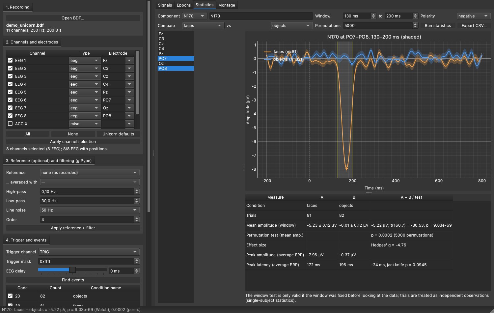

# Rhino ERP


Rhino ERP is a desktop app for offline **ERP analysis** of EEG recordings (BDF/EDF),
made for recordings from [Rhino Recorder](https://github.com/itubrainlab/rhinorecorder)
and the g.tec **Unicorn Hybrid Black**, on Windows, macOS and Linux. Load a recording,
pick channels, trigger and conditions, filter, compute ERPs, test a component between
two conditions, and export the whole analysis as a short MNE script.

- **MNE**: file loading, epoching, averaging, topographic maps
- **g.Pype**: zero-phase Butterworth filtering (high-pass, low-pass, line-noise notch)
  run as a g.Pype batch pipeline, plus the g.Pype Qt theme



## Download

Packages for Windows, macOS (Apple Silicon) and Linux are on the
[releases page](https://github.com/itubrainlab/rhinoerp/releases).

**First launch needs an internet connection.** The packages contain their own Python
and Rhino ERP, but not g.Pype: the g.tec Non-Commercial License does not allow g.Pype
to be redistributed in a bundle. On first launch the app downloads g.Pype, MNE and the
other libraries from PyPI (several hundred MB, a few minutes), at the versions the
release was tested with. Later launches start directly.

- **Windows**: unpack the zip and double-click `install.cmd`, then open Rhino ERP from
  the Start menu.
- **macOS**: open the DMG and drag **Rhino ERP** to Applications. The app is not
  notarized by Apple, so the first time, right-click it and choose **Open**.
- **Linux** (x86_64, glibc 2.34+): unpack the tarball and run `./install.sh`.

## Run from source

```bash
uv venv .venv --python 3.12 && uv pip install --python .venv/bin/python -e ".[test]"
.venv/bin/python -m rhino_erp path/to/recording.bdf
.venv/bin/python -m pytest -q
```

A synthetic test recording (oddball paradigm with blinks and 50 Hz noise):

```bash
.venv/bin/python scripts/make_demo_bdf.py demo.bdf
```

`packaging/` builds the three packages (`packaging/macos/build_app.sh`,
`packaging/linux/build_linux.sh`, `packaging/windows/build_windows.sh`); the
[workflow](.github/workflows/build.yml) builds, installs and checks them, and attaches
them to the release when a `v*` tag is pushed.

## Workflow

1. **Recording** – open a `.bdf` (an `.edf` also works).
2. **Channels and electrodes** – the first 8 channels are preselected as EEG and
   assigned the Unicorn Hybrid Black electrodes (Fz, C3, Cz, C4, Pz, PO7, Oz, PO8);
   all other channels start deselected as `misc`. Tick channels to include them in
   visualisation and analysis, set their type, and pick (or type) an electrode label
   per channel. A labelled channel is renamed to its electrode and gets the standard
   10-05 position, shown in the *Montage* tab. *Unicorn defaults* restores the
   preselection.
3. **Reference and filtering** – optionally re-reference the EEG (default: keep the
   recording reference; or the average of the selected EEG channels, one EEG channel,
   or the mean of two such as linked mastoids), then high-pass, low-pass and
   line-noise notch, run as a zero-phase g.Pype batch pipeline.
4. **Trigger and events** – choose the trigger channel (any channel, e.g. `TRIG` or
   BioSemi `Status`, or the file's annotations) and the bit mask, then *Find events*.
   Tick the codes to analyse and name them; codes sharing a name are pooled.
   **EEG delay** (slider or ms box, ±500 ms) compensates a recording delay between
   triggers and EEG: a positive value means the EEG lags, so events are moved later.
   It applies to the epochs and the event markers, and computed ERPs update live.
5. **Epochs and ERPs** – set the window, baseline and peak-to-peak rejection, then
   compute. The panel reports which channels caused rejections. The *Epochs* tab shows
   a single channel, the mean of selected channels, GFP or a butterfly plot; click the
   plot to set the topomap latency. ERPs can be saved as an MNE `-ave.fif` file.
   **Export as MNE script…** writes a short, commented Python script (MNE, NumPy,
   SciPy, matplotlib; no g.Pype) that reproduces the configured analysis. It starts
   with an editable settings block, then runs numbered steps: load and find events,
   channels and positions, reference and filters (MNE's zero-phase IIR Butterworth;
   the app's g.Pype filter differs by well under 0.1 µV), epochs, and - when a
   component is set up in the *Statistics* tab - topographic maps of the component
   window (each condition and their difference) plus the same statistics as the app
   (Welch t-test, permutation test, Hedges' g, peaks, jackknife latency test) and a
   graph of both conditions with the window and peaks. Only the steps the
   configuration needs are written.
6. **Statistics** (tab) – define the ERP component to test: pick a preset (P1, N1,
   N170, P2, N2, MMN, P300, N400, LPP) or edit the name, time window, polarity and
   channel cluster freely (any edit makes it *Custom*). Choose two conditions and run:
   - **window mean amplitude**: Welch t-test, label-permutation test, Hedges' g;
   - **peak amplitude and latency** on the average ERPs, with a jackknife test of the
     latency difference (withheld when a peak sits on the window edge, i.e. there is
     no clear peak).

   Statistics rerun automatically when the ERPs change (e.g. moving the EEG delay
   slider). *Export CSV…* writes per-trial window amplitudes plus a summary file.
   Trials are the observations, so these are single-subject statistics; the window
   test is only valid if the window was chosen before looking at the data.

## Licence

Rhino ERP is MIT licensed ([LICENSE](LICENSE)). g.Pype, which it uses for filtering
and which the packages install from PyPI on first launch, is under the g.tec
Non-Commercial License: free for private and educational use with a g.tec amplifier;
commercial use needs a licence from g.tec.
